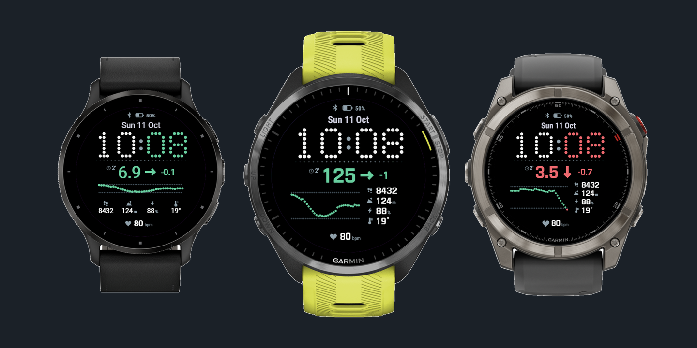
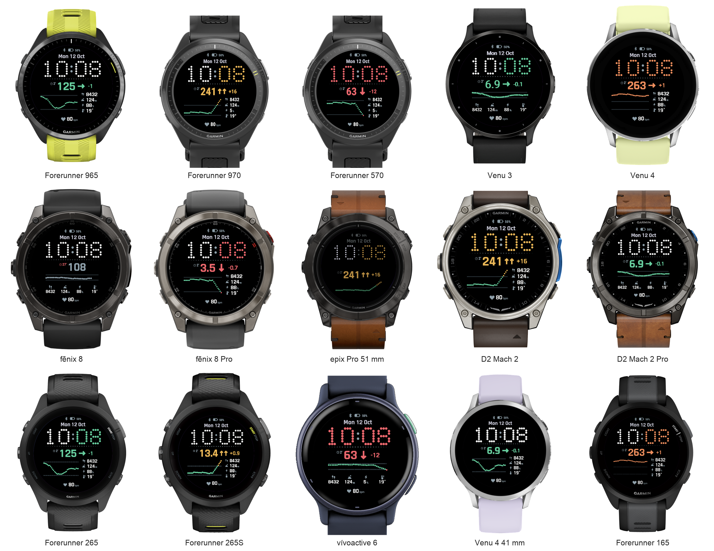

# Dotscout

A Garmin watch face that puts your continuous glucose reading next to the time, drawn in dots. Free on the [Connect IQ Store](https://apps.garmin.com/apps/838d7c3f-df37-4d58-80c7-28e9404f1c11).

- Glucose coloured by range, with a trend arrow, the 5-minute change and how old the reading is.
- A 3-hour graph between your low and high lines, scaled to fit, so a spike or a deep low shows at its real height.
- The time as a large dot matrix, white or tinted by your glucose range.
- Four data fields and a bottom field: steps, elevation gain, Body Battery, temperature and heart rate by default, or insulin and carbs on board and basal rate from your loop.
- A dim always-on mode that stays within AMOLED burn-in limits.
- mg/dL or mmol/L, in English or Spanish.

Colour only ever means glucose: green in range, amber high, orange very high, red low, grey when the reading is over 15 minutes old.

## Setup

1. Install Dotscout from the Connect IQ Store and choose it as your watch face.
2. In the Connect IQ app on your phone, open Dotscout's settings and pick your data source:
   - **Nightscout**: your site's URL, such as `https://example.herokuapp.com`, and a token with the `readable` role (Admin Tools in Nightscout). Public sites work without a token, but with one the graph fills in on the first fetch.
   - **xDrip+**: in xDrip+, enable Settings > Inter-app settings > xDrip Web Server.
   - **AndroidAPS**: enable the Garmin plugin in Config Builder.

Readings arrive through the Garmin Connect app on your phone. Connect IQ lets a watch face fetch at most every 5 minutes, and Dotscout times each fetch for just after your next reading is expected, so it usually lags your CGM by seconds.

## Settings

| Setting | Values |
| --- | --- |
| Data source | Nightscout (default), xDrip+, AndroidAPS, or Demo (simulated data) |
| Nightscout URL, Nightscout token | Your site, and a read-only token |
| Units | mg/dL or mmol/L |
| Low threshold, High threshold | In either unit: values under 30 are read as mmol/L (3.9 or 70; 10 or 180) |
| Layout | Tall graph with the fields beside it (default), or Classic with the fields below |
| Time colour | White, minutes by glucose, or the whole time by glucose |
| Data fields 1–4, Bottom field | Steps, elevation gain, Body Battery, temperature, heart rate, insulin on board, carbs on board, basal rate, battery, calories, VO2 max, stress, floors or weekly active minutes |

12/24-hour time and always-on follow the watch's own settings. Very high starts at 250 mg/dL.

## Supported watches

Round AMOLED watches:

- **Forerunner** 965, 970, 570, 265, 265S, 165, 170 and 70
- **fēnix** 8 (43, 47 and 51 mm AMOLED), fēnix 8 Pro and fēnix E
- **epix** (Gen 2) and epix Pro (Gen 2), 42, 47 and 51 mm
- **Venu** 3, 3S and Venu 4 (41 and 45 mm), **vívoactive** 6
- **MARQ** (Gen 2) and MARQ Aviator, **D2** Mach 1, Mach 2 and Mach 2 Pro, and models sharing those profiles (tactix 7/8, quatix 8, D2 Air X15)

MIP watches such as the fēnix 7, Forerunner 255/955 and Instinct aren't supported yet.

## Troubleshooting

- **"Set your Nightscout URL"**: enter your site in the face's settings, without `/api` at the end.
- **"Token refused"**: paste the whole token (it looks like `name-1234567890abcdef`) and check it has the `readable` role.
- **"Phone not connected"**: the watch fetches through Garmin Connect, so keep the phone nearby with the app running.
- **Empty graph after installing**: with a token it fills on the first fetch; without one it fills over 3 hours.

Questions, problems or ideas: [open an issue](https://github.com/AlFontal/dotscout-garmin/issues).

## Privacy and safety

Your Nightscout URL and token stay in the face's settings on your phone and watch, and are sent only to the site you entered. Dotscout collects no analytics and has no servers of its own.

Dotscout is not a medical device. Don't use it to make treatment decisions; always check your CGM app or meter.

## Contributing

Building, testing, the design notes and the release process are in [CONTRIBUTING.md](CONTRIBUTING.md).

## Licence

MIT, see [LICENSE](LICENSE). The watch images in `docs/store/` are Garmin's device renders from the Connect IQ SDK, © Garmin, and are not covered by this licence.
